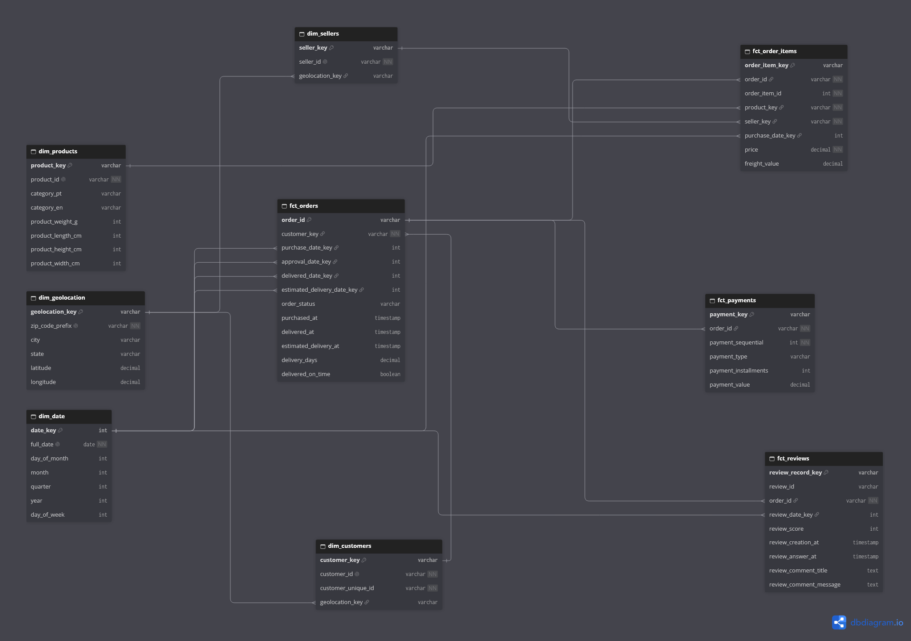

# Olist Analytics Engineering

An end-to-end analytics engineering project built on the Brazilian e-commerce dataset from Olist. 
Transforms raw transactional data into a dimensional model ready for business intelligence, using dbt, DuckDB and Power BI.

## Architecture



## Data Model

The project follows Kimball dimensional modeling with four fact tables and five dimensions:

**Fact tables:**
- `fct_orders` - one row per delivered order. Includes delivery performance metrics.
- `fct_order_items` - one row per item within an order. Enables revenue analysis by product, category and seller.
- `fct_payments` - one row per payment. Supports multi-payment order analysis.
- `fct_reviews` - one row per customer review. Enables satisfaction analysis over time.

**Dimensions:**
- `dim_customers` - SCD Type 2. Tracks customer location changes over time.
- `dim_products` - product catalogue with category translations (PT → EN).
- `dim_sellers` - seller location data.
- `dim_geolocation` - zip code level coordinates for geographic analysis.
- `dim_date` - standard date dimension with year, month, quarter, day of week.

## Key Metrics

| Metric | Definition |
|--------|------------|
| Total Revenue | Sum of payment_value for delivered orders (BRL) |
| Total Orders | Count of unique delivered orders |
| Avg Days to Deliver | Calendar days between purchase and delivery |
| On-Time Delivery Rate | % of orders delivered on or before estimated date |
| Avg Review Score | Average customer score (1–5) |

Full metric definitions and assumptions: [metric_definitions.md](transform/metric_definitions.md)

## How to Run

**1. Install dependencies:**
```bash
pip install dbt-core dbt-duckdb duckdb
```

**2. Load raw data:**
```bash
python extract/load_olist.py
```

**3. Build dbt models:**
```bash
cd transform
dbt deps
dbt build
```

## Project Structure
olist-analytics-engineering/
├── extract/ # Python extraction scripts
│ └── load_olist.py # Idempotent CSV loader
├── transform/ # dbt project
│ ├── models/
│ │ ├── staging/ # Raw data cleaning and renaming
│ │ ├── intermediate/ # Joins and business logic
│ │ └── marts/ # Fact tables and dimensions
│ ├── snapshots/ # SCD Type 2 (dim_customers)
│ ├── tests/ # Data reconciliation tests
│ └── macros/ # Reusable SQL macros
├── powerbi_data/ # CSV exports for Power BI
├── docs/ # Architecture diagrams and screenshots
└── .github/workflows/ # CI pipeline


## Data Quality

The project includes 37+ automated tests covering:
- Primary key uniqueness and not-null constraints
- Referential integrity between fact and dimension tables
- Custom positive_values test for financial metrics
- Revenue reconciliation between marts and staging layer

## CI/CD

GitHub Actions runs `dbt build` on every pull request. Direct pushes to `main` are not permitted.

## Dataset

[Olist Brazilian E-Commerce](https://www.kaggle.com/datasets/olistbr/brazilian-ecommerce) - 100K orders from 2016 to 2018 across multiple Brazilian marketplaces.